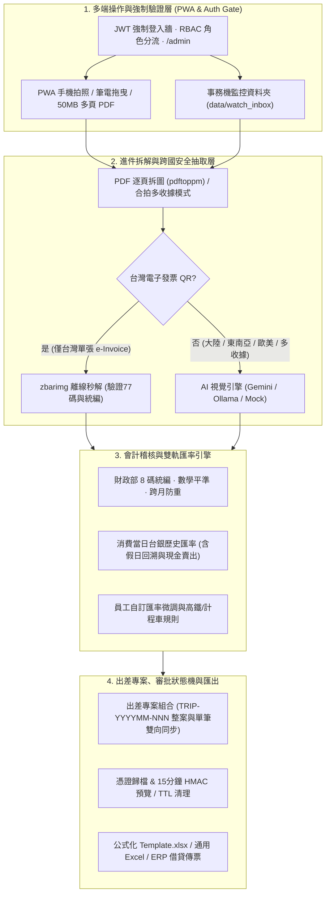

<div align="center">

# 🧾 AI-Invoice-Auditor

### 中小型企業智慧發票辨識、出差專案管理與財務審批系統
**AI-Powered Expense Auditing, Business Trip Bundles, Multi-FX & Approval Portal for SMBs**

<br/>

[](https://www.python.org/)
[](https://fastapi.tiangolo.com/)
[](#)
[](DOCKER_GUIDE.md)
[](LICENSE)

<br/>

🌐 **[繁體中文](README.md)** | **[English](README_EN.md)**

</div>

---

## 📌 專案定位：專為中小型企業（5～50 人團隊）打造

對中小型企業、新創與跨國出差團隊而言，傳統大型 ERP 費用系統建置成本高、維護繁瑣；但純靠手工填寫出差報銷單與換算多國匯率，每月都會消耗同仁與財務大量工時：

* **出差同仁痛點**：一趟出差動輒數十到上百張機票、高鐵票、住宿與海外收據，得逐張鍵入公式 Excel 並查詢消費當日匯率。
* **財務會計痛點**：人工檢查 8 碼統一編號、驗算未稅 + 5% 稅額、提防跨月重複請款，還要在分散的單據中核對整趟出差的總開銷。
* **IT 與老闆痛點**：希望預算輕量、資料可控、可選擇雲端 AI 或全地端私有推論，並能直接部署於辦公室主機、NAS 或低成本 VPS。

**`AI-Invoice-Auditor`** 提供一套**開箱即用、零重型基礎設施**的全流程報銷平台：從 **PWA 手機拍照 / 事務機監控資料夾 / 多頁 PDF 拆頁** 進件開始，自動經過 **台灣 QR 高速預解 / 多模態 AI 抽取 → 會計規則稽核 → 消費當日台銀或自訂匯率折算 → 歸組出差專案與公式化 Excel 匯出 → 財務審批與撥款結案**。

---

## ✨ 核心功能亮點

1. **📱 極簡 SaaS 介面、4 層 RWD 與 PWA 手機桌面安裝**
   * 介面遵循極簡原則，日常操作聚焦上傳與核心結果；篩選工具列（`🔍 篩選`）、進階引擎／匯率設定與教學指引皆採預設折疊，需要時一鍵展開。
   * 內建 **PWA (`manifest.json` + `/sw.js`)**，手機瀏覽器點擊「加入主畫面」即可像原生 App 一樣一鍵打開拍照上傳（Service Worker 嚴格略過 `/api/` 與 `/admin` 快取，不暫存任何帳密或敏感單據）。
2. **🤖 多引擎 AI 架構 & 輕鬆擴充（Gemini / Ollama / OpenAI 相容延伸）**
   * **Google Gemini（預設 `gemini-3.7-flash`）**：雲端多模態視覺理解，支援中／英／日／東南亞／歐美跨國單據與 Pydantic v2 嚴格 JSON Schema 輸出。
   * **地端 Ollama（如 `llama3.2-vision`、`qwen2.5-vl`）**：Web 前端引擎選單與 CLI 皆可直接切換，高敏感憑證推論**完全不出企業內網**。
   * **確定性 Mock 引擎**與標準 **`BaseInvoiceExtractor` 抽象介面**（`extract()` / `extract_many()`）：無需 API Key 即可測試全流程，亦方便擴充串接 OpenAI GPT-4o、Claude 或任何 OpenAI-Compatible API（vLLM / Azure OpenAI）。
3. **🧳 出差報銷專案組合（Business Trip Bundles）**
   * 支援為每次出差建立專屬專案案號（`TRIP-YYYYMM-NNN`），員工可**分批上傳數十至 100+ 張單據**自動彙總到同一案號（含預支旅費扣抵、出差天數自動計算與分批上傳進度條）。
   * 支援**整案送審、單張發票退件聯動母專案（雙向狀態同步 `RETURNED` ⇄ `SUBMITTED`）、整案核准／撥款結案**，並可一鍵匯出自動動態擴展列數與公式之整趟企業報銷單。
4. **⚡ 大量紙本快速進件（多頁 PDF 拆頁＋跨國安全 QR 解碼＋事務機監控夾）**
   * **多頁 PDF 自動逐頁拆解 (`pdftoppm`)**：支援最高 **50 MB** 掃描機整合 PDF（圖片單檔 20 MB），啟用 `split_pdf` 後自動逐頁轉圖並逐頁建帳，每頁獨立保留 15 分鐘預覽憑證。
   * **單張照片多收據合拍 (`multi_receipt`)**：桌面平鋪多張發票合拍 1 張照片時，自動拆出多筆獨立報銷明細。
   * **跨國防誤判之台灣電子發票 QR Code 優先解碼 (`zbarimg`)**：未開啟多收據合拍時優先離線解碼 QR，嚴格校驗財政部 77 字元格式、合法民國日期、金額與賣方 8 碼統編校驗碼；**自動精準跳過大陸增值稅/數電發票（`01,...`）、東南亞 PromptPay/PayNow 與歐美網址 QR**，確保海外單據安全交由 AI 視覺辨識不誤判。
   * **事務機掃描「自動監控資料夾」(`data/watch_inbox/`)**：整疊紙本掃成 PDF 投入監控資料夾（若置於同名 `TRIP-YYYYMM-NNN/` 子資料夾還可自動綁定該出差案），支援進階面板一鍵匯入或設定 `WATCH_FOLDER_AUTO_POLL_SECONDS` 定時輪詢，處理完成自動歸檔至 `processed/` 防止重複進件。
5. **💱 雙軌匯率控制（消費當日台銀牌告＋員工自訂匯率）**
   * **自動抓取消費當日臺灣銀行歷史匯率**：整合 FinMind 臺灣銀行牌告資料與期交所 CSV，自動處理**週末與國定假日回溯最近營業日**；針對馬來西亞令吉（`MYR`）、越南盾（`VND`）、印尼盾（`IDR`）、菲律賓披索（`PHP`）、韓元（`KRW`）等無即期報價之亞洲／東南亞幣別自動切換 **現金賣出**。
   * **員工自訂匯率與事後單筆微調**：上傳時或於歷史紀錄／專案明細點擊 **`匯率`**，皆可即時試算台銀當日匯率或手動填寫信用卡請款實際匯率，同步反映至資料庫台幣總額、動態公式化 [Template.xlsx](Template.xlsx)（`Report!J` 列）與 ERP 會計分錄。
6. **🛡️ 會計稽核防呆、強制登入驗證牆與嚴格 RBAC 隔離**
   * **台灣財政部 8 碼統編權重校驗** `[1, 2, 1, 2, 1, 2, 4, 1]`、`未稅 + 5% 稅額 == 總金額` 平準檢查、高鐵站名／計程車超額警示與 **SQLite 跨月防重複請款攔截**。
   * **全站強制登入驗證牆 (`#auth-gate-screen`) + 嚴格 RBAC**：未登入僅見登入畫面；一般員工（`employee`）僅能見上傳、個人出差專案與個人歷史單據，跨人與管理端點嚴格回傳 `401`/`403`；財務主管（`accountant`）／管理員（`admin`）專屬開啟審批中心、用量分析與 **SQLAdmin（`/admin`）管理後台**。
7. **🗂️ 原始憑證持久化、HMAC 安全預覽與企業匯出**
   * 上傳憑證依 `data/uploads/<user_id>/<YYYY-MM>/` 歸檔並以 **15 分鐘效期 HMAC-SHA256 簽章連結**（具所有權與路徑穿越防護）線上檢視；支援套入含公式的 [Template.xlsx](Template.xlsx)、通用明細 Excel、雙式借貸平衡 ERP 傳票（CSV/JSON）與 TTL 過期暫存清理。

---

## 📊 效益比較矩陣

| 評估維度 | 傳統人工手填報銷 | 傳統規則型 OCR | AI-Invoice-Auditor（中小型企業版） |
| :--- | :--- | :--- | :--- |
| **出差大量紙本進件** | 逐張打字、貼 Excel、對匯率 | 換版型或褶皺即失效 | **PWA 隨手拍 / 事務機監控夾 / 多頁 PDF 拆頁 / 合拍拆分** |
| **跨國單據與 QR 處理** | 自行換算多國匯率易出錯 | 僅支援固定單一國別模板 | **台灣 QR 零費用秒解；大陸/東南亞/歐美安全交 AI + 消費日台銀匯率** |
| **出差專案與審批追蹤** | 散落多封信件與 Excel 檔 | 無專案聚合與審批狀態 | **TRIP 案號整批歸組、退件雙向同步、整案核准撥款** |
| **會計合規與資料安全** | 人工肉眼對統編與總額 | 無權限隔離與稽核軌跡 | **強制登入 RBAC + 8 碼統編/5% 稅額/防重 + 地端 Ollama 可選** |
| **建置與維護成本** | 財務與員工工時高昂 | 授權費高、維護複雜 | **Docker 30 秒上線，支援雲端 Gemini 與地端 Ollama** |

---

## ⚙️ 系統架構



---

## 🚀 快速開始 (Quick Start)

### 方式 A：Docker Compose 一鍵啟動（最推薦，30 秒上線）

已內建 `poppler-utils`（PDF 拆頁）與 `zbar-tools`（台灣 QR 解碼），適合部署於辦公室主機、Synology/QNAP NAS 或雲端輕量 VPS，詳細操作可參閱 [輕量容器化部署手冊 (DOCKER_GUIDE.md)](DOCKER_GUIDE.md)：

```bash
git clone https://github.com/Json105/AI-Invoice-Auditor.git
cd AI-Invoice-Auditor

# 1. 建立環境設定檔（正式上線請務必修改密鑰與 API Key）
cp .env.example .env

# 2. 啟動 Web Portal
docker compose up -d --build
```

啟動後開啟瀏覽器：
* **員工報銷與財務審批中心**：`http://localhost:8000/`
* **SQLAdmin 帳號與資料管理後台**：`http://localhost:8000/admin`

---

### 方式 B：本機 Python 直接啟動 Web Portal

```bash
git clone https://github.com/Json105/AI-Invoice-Auditor.git
cd AI-Invoice-Auditor
pip install -r requirements.txt

# 選填：於 Ubuntu/Debian 安裝系統輔助工具以啟用多頁 PDF 拆頁與台灣 QR 秒解
sudo apt-get update && sudo apt-get install -y poppler-utils zbar-tools

# 選填：設定 Gemini API Key（若未設定亦可於網頁進階設定選用 Ollama 或 Mock）
export GEMINI_API_KEY="your-gemini-api-key"

# 啟動 FastAPI 服務
python3 -m uvicorn src.web.app:app --host 0.0.0.0 --port 8000
```

---

### 方式 C：CLI 批次處理模式

適合自動化排程或快速離線驗證：

```bash
# 1. 零依賴離線展示（自動套入樣本資料）
python3 -m src.main --input sample_data --engine mock --output output --template Template.xlsx

# 2. 使用 Google Gemini 批次辨識真實單據
export GEMINI_API_KEY="your-gemini-api-key"
python3 -m src.main --input /path/to/your/invoices --engine gemini --model gemini-3.7-flash --template Template.xlsx

# 3. 使用地端 Ollama 離線保密辨識
ollama run llama3.2-vision
python3 -m src.main --input /path/to/your/invoices --engine ollama --template Template.xlsx
```

產出檔案位於 `output/`（Web Portal 匯出檔案位於 `output/web_sessions/<session_id>/`）：
* `Travel_Expenses_Report_Filled.xlsx` / `<TRIP_CODE>_Travel_Expenses_Report.xlsx`：自動填入之公司公式化報銷表
* `expense_claim_report.xlsx`：通用報銷明細表
* `erp_journal_entry.csv` / `erp_journal_entry.json`：ERP 借貸平衡會計傳票分錄
* `audit_trail.json`：完整結構化稽核紀錄

---

## 🔑 預設體驗帳號與正式上線安全檢查清單

系統首次啟動並初始化 `data/invoices.db` 時，會建立以下 **僅供展示與測試** 的預設帳號：

| 角色 | 示範信箱 | 預設密碼 | 主要權限範圍 |
| :--- | :--- | :--- | :--- |
| 👑 **系統管理員 (`admin`)** | `admin@company.local` | `Admin1234!` | 全站存取、`/admin` 帳號權限管理、系統用量與儲存清理、所有部門單據 |
| 💼 **財務主管 (`accountant`)** | `finance@company.local` | `Finance1234!` | 財務審批中心（整案與單筆核准／退件／撥款結案）、用量分析與 `/admin` 後台 |
| 👤 **一般同仁 (`employee`)** | `employee@company.local` | `User1234!` | 單據辨識與稽核、個人出差專案管理、調整自己單據之匯率與查詢個人歷史紀錄 |

> [!CAUTION]
> **正式環境上線前必做安全事項**：
> 1. **更換密鑰**：務必在 `.env` 設定高強度隨機 `JWT_SECRET_KEY` 與 `ADMIN_SESSION_SECRET`（例如執行 `openssl rand -hex 32`），切勿沿用開發預設字串。
> 2. **停用或更換示範帳號**：首次部署後請立即登入或進入 `/admin` 修改／停用上述 `@company.local` 示範帳號，建立同仁真實帳號並移除前端快速體驗按鈕。
> 3. **啟用 HTTPS 與邊界防護**：若透過公網存取（取代內網 VPN），請搭配 Nginx、Caddy 或 **Cloudflare Tunnel + Access** 提供 HTTPS 加密（手機安裝 PWA 與呼叫相機亦需 HTTPS），並在反向代理層加上登入速率限制（Rate Limiting）與 CORS 白名單。
> 4. **RBAC 權限邊界**：目前全站 API（包含 `/api/audit`、`/api/trips/*`、`/api/approval/*`、`/api/storage/stats|cleanup|presigned-url`、`/api/records/*`、`/api/watch-folder/*`）皆強制驗證 JWT Bearer Token 與角色／擁有者權限（未登入回 `401`、一般員工越權存取或批核回 `403`）。
> 5. **定期備份**：將 `./data/`（含 `invoices.db`、`data/uploads/`、`data/watch_inbox/`）及 `./output/` 納入定期備份。

---

## ⚙️ 環境變數說明

可複製 [`.env.example`](.env.example) 為 `.env` 進行設定：

| 環境變數名稱 | 必要性 | 說明 |
| :--- | :--- | :--- |
| `GEMINI_API_KEY` | 選填 | Google Gemini API Key；留空時仍可使用地端 Ollama、台灣 QR 解碼或 Mock 模式 |
| `JWT_SECRET_KEY` | 正式必設 | JWT 登入權杖與 HMAC 限時預覽連結的簽章密鑰（請設為高強度隨機值） |
| `ADMIN_SESSION_SECRET` | 正式必設 | `/admin` SQLAdmin 管理後台 Session Cookie 加密密鑰 |
| `DATABASE_URL` | 選填 | 資料庫連線字串，預設為 `sqlite:///data/invoices.db`（亦支援 PostgreSQL 連線格式） |
| `WATCH_FOLDER_DIR` | 選填 | 事務機掃描監控資料夾路徑，預設為 `data/watch_inbox` |
| `WATCH_FOLDER_AUTO_POLL_SECONDS` | 選填 | Watch Folder 背景自動輪詢秒數（預設 `0` 為僅手動點擊掃描，設為 `30` 即每 30 秒自動巡檢匯入） |
| `S3_BUCKET_NAME` / `S3_ENDPOINT_URL` / `AWS_ACCESS_KEY_ID` / `AWS_SECRET_ACCESS_KEY` | 選填預留 | 物件儲存 Provider 設定；未配置時自動使用本地磁碟與 Docker Volume |

---

## 🧩 客製化貴公司 Excel 範本

專案隨附的 [Template.xlsx](Template.xlsx) 為**已完全脫敏之通用差旅報銷範本**，內含 `Report`、`Rates`、`Calc`、`E category` 等四張連動計算工作表與外幣換算公式（系統亦支援超越模板預設列數的動態公式自動延伸）。若貴公司已有財務規定的標準差旅報銷單：

1. 直接以貴公司的 `.xlsx` 表單覆蓋根目錄的 [Template.xlsx](Template.xlsx)（或保留自訂路徑於 CLI `-t` 參數使用）。
2. 依公司表格的儲存格座標調整 [`src/template_exporter.py`](src/template_exporter.py) 內的寫入欄位與分類規則（`F / I / T / H / S / E`），即可在不破壞原表單既有 Excel 公式與版面的情況下自動填入報銷內容。

---

## 📁 專案目錄結構

```text
AI-Invoice-Auditor/
├── .env.example                 # 環境變數範本（含 Watch Folder 設定說明）
├── DOCKER_GUIDE.md              # 5~50 人團隊 Docker 容器化部署手冊
├── Dockerfile                   # 輕量 Python 3.10 映像（含 poppler-utils 與 zbar-tools）
├── LICENSE                      # MIT 開源授權條款
├── README.md                    # 繁體中文說明文件
├── README_EN.md                 # 英文版說明文件
├── Template.xlsx                # 已脫敏之通用含公式差旅報銷 Excel 範本
├── docker-compose.yml           # 一鍵啟動服務與持久化 Volume 設定
├── requirements.txt             # Python 相依套件清單
├── sample_data/                 # 合成與脫敏測試單據樣本（含台灣/海外憑證與錯誤案例）
├── scripts/
│   └── check-done.sh            # 專案離線驗收腳本（語法檢查 + 全套 Pytest）
├── src/
│   ├── main.py                  # CLI 批次處理入口
│   ├── models.py                # Pydantic v2 發票、匯率與審核模型
│   ├── auditor.py               # 統編加權檢核、數學平準與跨月防重複稽核引擎
│   ├── database.py              # SQLite WAL / SQLAlchemy 模型、帳號、出差專案與審批狀態機
│   ├── exporter.py              # 通用 Excel 明細表與 JSON 審計日誌匯出
│   ├── template_exporter.py     # 公司公式化 Template.xlsx 自動填入、動態擴展與逐筆匯率公式
│   ├── erp_exporter.py          # ERP 雙式借貸分錄傳票 CSV/JSON 匯出
│   ├── extractors/              # Gemini / Ollama / Mock 多模態抽取器（支援單張多收據 extract_many）
│   ├── services/                # auth_service (JWT), fx_service (台銀歷史匯率), tw_einvoice_qr, document_splitter, watch_folder, ingestion_pipeline, storage_service
│   └── web/                     # FastAPI Web Portal、RBAC/出差專案/審批/儲存/監控夾路由、SQLAdmin 後台與 PWA + RWD 前端
└── tests/                       # 62 項完整離線單元與全角色端到端整合測試套件
```

---

## 🧪 自動化測試與驗收

專案內建 **62 項完整離線自動化測試**（涵蓋 `MockExtractor`、`qrencode` 合成條碼、多頁 PDF 與獨立 `TestClient`，無需真實外部金鑰即可執行）：

```bash
# 執行完整專案驗收檢查（Python 語法 + 前端 JS 語法 + 全部 Pytest）
./scripts/check-done.sh

# 或單獨執行完整測試套件
pytest -v
```

測試涵蓋：
* 台灣財政部 8 碼統編權重與模 10 邏輯檢核、5% 營業稅平準與誤差容許、重複發票攔截。
* 出差報銷專案 CRUD、分批匯入與草稿隔離、單筆退件與整案核准／撥款之雙向狀態同步、100+ 筆動態 Excel 公式擴展。
* 多頁 PDF 逐頁拆解（`pdftoppm`）、單張多收據合拍拆分、跨國安全之台灣 QR 秒解 vs 大陸／東南亞／歐美 QR 安全回退 AI、Watch Folder 監控匯入與歸檔。
* 消費當日臺灣銀行歷史匯率（含週末回溯與東南亞現金賣出回退）、員工自訂匯率覆寫與報表／ERP 同步折算。
* 強制登入驗證牆、全角色 RBAC 權限邊界、`/admin` SQLAdmin 管理列表與 PWA / 前端事件完整性檢查。

---

## 📄 授權條款

本專案採用 **[MIT License](LICENSE)** 授權條款，歡迎自由使用、修改與部署於團隊內部環境。
