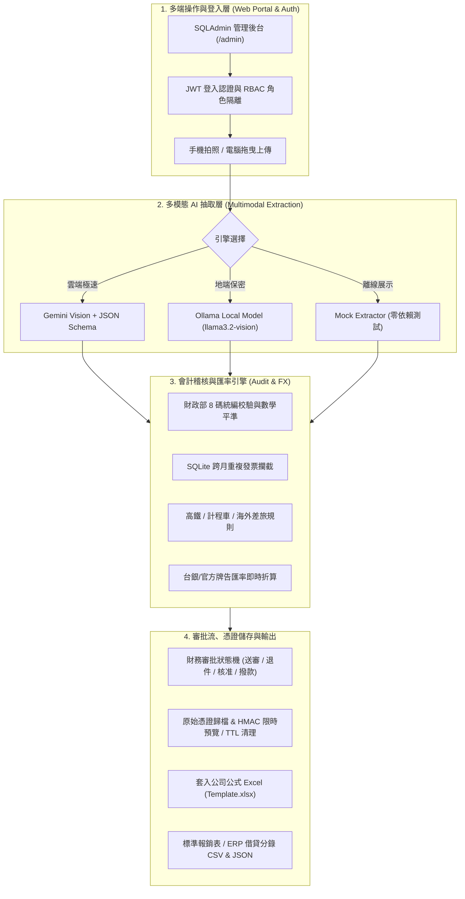

<div align="center">

# 🧾 AI-Invoice-Auditor

### 中小型企業智慧發票辨識、差旅報銷與財務審批系統
**AI-Powered Expense Auditing, Travel Reimbursement & Approval Portal for SMBs**

<br/>

[](https://www.python.org/)
[](https://fastapi.tiangolo.com/)
[](#)
[](DOCKER_GUIDE.md)
[](LICENSE)

<br/>

🌐 **[繁體中文](README.md)** | **[English](README_EN.md)**

</div>

---

## 📌 專案定位：專為中小型企業（5～50 人團隊）打造

對中小型企業、新創與成長型團隊而言，導入傳統大型 SaaS 費用系統或客製化 ERP 往往成本高昂、流程繁瑣；但純靠手工填寫出差報銷單與對帳，又常讓同仁與財務每月耗費大量工時：

* **出差同仁痛點**：外地奔波收集的統一發票、高鐵票根、計程車收據、海外飯店與叫車憑證，還得手動鍵入公司 Excel 表並自行換算外幣匯率。
* **財務會計痛點**：人工核對 8 碼統一編號、檢驗未稅 + 5% 稅額是否平衡、提防跨月重複請款、追蹤誰送審與誰已撥款。
* **IT 與老闆痛點**：希望預算輕量、資料可控、免複雜 AD/SSO 建置，最好能直接跑在辦公室電腦、NAS 或低成本 VPS 上。

**`AI-Invoice-Auditor`** 提供一套**開箱即用、零重型基礎設施**的全流程報銷平台：同仁用手機拍照或電腦上傳單據，系統即自動完成 **AI 結構化抽取 → 會計規則稽核 → 套入含計算公式的公司 Excel 範本 → 進入財務審批流與憑證歸檔**。

---

## ✨ 核心功能亮點

1. **📱 簡約淺色 SaaS 介面 & 手機拍照上傳（4 層 RWD）**
   * 支援手機鏡頭直接拍攝收據與電腦批次拖曳上傳（支援 `JPG`、`PNG`、`WEBP`、`PDF`、`TIFF`、`BMP` 及 JSON 測試檔，單檔上限 20 MB）。
   * 介面依據螢幕寬度自動於桌面表格與手機卡片排版間切換，外勤與筆電作業皆可流暢操作。
2. **🤖 雙模 AI 辨識引擎（雲端極速 vs. 地端保密）**
   * **Google Gemini（預設 `gemini-3.7-flash`）**：多模態視覺理解搭配 Pydantic v2 嚴格 Schema 輸出。
   * **地端 Ollama（如 `llama3.2-vision`）**：支援完全離線私有推論，高敏感採購與商務憑證資料**不出企業內網**。
   * **確定性 Mock 引擎**：無需 API Key 即可完整驗證流程與測試系統功能。
3. **🛡️ 會計稽核防呆與跨月防重複**
   * **台灣財政部 8 碼統編校驗**：實作加權乘數 `[1, 2, 1, 2, 1, 2, 4, 1]` 模 10 演算法驗證買方與賣方統編。
   * **數學平準檢核**：自動比對 `未稅金額 + 5% 營業稅 == 總金額` 與低信賴度預警。
   * **SQLite 跨月防弊**：自動比對歷史報銷發票／收據號碼，攔截重複請款。
   * **差旅專屬檢查**：台灣高鐵合法站名驗證、計程車高額車資提醒，並支援海外餐飲、住宿與叫車外幣憑證。
4. **📊 公式化公司 Excel 範本 & 台銀/官方即時匯率**
   * 直接將審核資料填入含換算與統計公式的 [Template.xlsx](Template.xlsx)（完整保留既有公式與圖表結構）。
   * 整合台灣期交所與央行公開牌告匯率（具 4 小時快取與離線備援匯率），支援 `TWD/NT$`、`USD`、`EUR`、`RMB/CNY`、`JPY`、`THB`、`HKD`、`GBP`、`AUD`、`SGD`。
   * 同步產出通用報銷清冊（`expense_claim_report.xlsx`）、ERP 會計借貸分錄（`erp_journal_entry.csv` / `.json`）與 JSON 稽核軌跡（`audit_trail.json`）。
5. **✅ 小團隊財務審批工作流（Approval Workflow）**
   * 內建完整報銷單狀態機：`SUBMITTED`（待審）→ `APPROVED`（核准）／`RETURNED`（退件補件）／`REJECTED`（駁回）→ `PAID`（已撥款結案）。
   * 財務人員可使用快速審核意見標籤完成退件或核准；員工在單據被退件後可直接重送審核。
6. **🔐 JWT 角色權限與 `/admin` 管理後台**
   * 區分 **系統管理員（`admin`）**、**財務主管（`finance` / `accountant`）** 與 **一般員工（`employee`）**，員工僅可查閱與下載自己上傳的報銷紀錄與憑證。
   * 內建 **SQLAdmin 管理後台（`/admin`）**，管理員可直接以「公司信箱 + 密碼」手動新增員工帳號（系統自動以 bcrypt 雜湊加密），同仁亦可隨時線上變更個人密碼。
7. **🗂️ 原始憑證持久化與 HMAC 安全預覽**
   * 上傳憑證依「使用者 / 年月」安全歸檔保存，提供 **15 分鐘效期 HMAC-SHA256 簽章預覽連結**（支援圖片與 PDF 線上檢視及路徑穿越防護），並附磁碟統計與 TTL 過期暫存清理機制（程式碼已預留 S3 / MinIO / Cloudflare R2 `StorageProvider` 擴充介面）。

---

## 📊 效益比較矩陣

| 評估維度 | 傳統人工手填報銷 | 傳統規則型 OCR | AI-Invoice-Auditor（中小型企業版） |
| :--- | :--- | :--- | :--- |
| **員工填單負擔** | 逐張打字、人工貼 Excel 與查匯率 | 仍需大量人工校對欄位 | **手機拍照即辨識，自動帶入公式化 Excel** |
| **非固定版面適應** | 依賴人力判斷，易疲勞出錯 | 換行、摺痕、海外單據即失效 | **多模態視覺理解中英文發票、票根與海外收據** |
| **會計規則與防弊** | 人工肉眼對統編與總額 | 需寫大量客製化正規式腳本 | **內建 8 碼統編校驗、數學平準與跨月防重複** |
| **審批與憑證留存** | Excel / 紙本往返，進度不透明 | 無審批狀態與權限管理 | **送審／退件／撥款狀態機 + 原圖 HMAC 限時預覽** |
| **建置與資安成本** | 人力成本高、紙本易遺失 | 授權費高、維護複雜 | **Docker 30 秒啟動，支援雲端 Gemini 與地端 Ollama** |

---

## ⚙️ 系統架構



---

## 🚀 快速開始 (Quick Start)

### 方式 A：Docker Compose 一鍵啟動（最推薦，30 秒上線）

適合部署於辦公室主機、Synology/QNAP NAS 或雲端輕量 VPS，詳細操作可參閱 [輕量容器化部署手冊 (DOCKER_GUIDE.md)](DOCKER_GUIDE.md)：

```bash
git clone https://github.com/Json105/AI-Invoice-Auditor.git
cd AI-Invoice-Auditor

# 1. 建立環境設定檔（正式上線請務必修改密鑰與 API Key）
cp .env.example .env

# 2. 啟動 Web Portal
docker compose up -d --build
```

啟動後開啟瀏覽器：
* **員工報銷與財務審批中心**：`http://localhost:8000/`
* **SQLAdmin 帳號與資料管理後台**：`http://localhost:8000/admin`

---

### 方式 B：本機 Python 直接啟動 Web Portal

```bash
git clone https://github.com/Json105/AI-Invoice-Auditor.git
cd AI-Invoice-Auditor
pip install -r requirements.txt

# 選填：設定 Gemini API Key（若未設定亦可選擇 Mock 或地端 Ollama）
export GEMINI_API_KEY="your-gemini-api-key"

# 啟動 FastAPI 服務
python3 -m uvicorn src.web.app:app --host 0.0.0.0 --port 8000
```

---

### 方式 C：CLI 批次處理模式

適合自動化排程或快速離線驗證：

```bash
# 1. 零依賴離線展示（自動套入樣本資料）
python3 -m src.main --input sample_data --engine mock --output output --template Template.xlsx

# 2. 使用 Google Gemini 批次辨識真實單據
export GEMINI_API_KEY="your-gemini-api-key"
python3 -m src.main --input /path/to/your/invoices --engine gemini --model gemini-3.7-flash --template Template.xlsx

# 3. 使用地端 Ollama 離線保密辨識
ollama run llama3.2-vision
python3 -m src.main --input /path/to/your/invoices --engine ollama --template Template.xlsx
```

產出檔案位於 `output/`（Web Portal 匯出檔案位於 `output/web_sessions/<session_id>/`）：
* `Travel_Expenses_Report_Filled.xlsx`：自動填入之公司公式化報銷表（有提供範本時）
* `expense_claim_report.xlsx`：通用報銷明細表
* `erp_journal_entry.csv` / `erp_journal_entry.json`：ERP 借貸平衡會計傳票分錄
* `audit_trail.json`：完整結構化稽核紀錄

---

## 🔑 預設體驗帳號與正式上線安全檢查清單

系統首次啟動並初始化 `data/invoices.db` 時，會建立以下 **僅供展示與測試** 的預設帳號：

| 角色 | 示範信箱 | 預設密碼 | 主要權限範圍 |
| :--- | :--- | :--- | :--- |
| 👑 **系統管理員 (`admin`)** | `admin@company.local` | `Admin1234!` | 全站存取、`/admin` 帳號權限管理、檢視所有部門單據 |
| 💼 **財務主管 (`finance`)** | `finance@company.local` | `Finance1234!` | 財務審批中心（核准 / 退件 / 駁回 / 撥款結案）、匯出清冊與 ERP 分錄 |
| 👤 **一般同仁 (`employee`)** | `employee@company.local` | `User1234!` | 上傳發票送審、僅查閱個人報銷歷史、憑證原圖與被退件重送 |

> [!CAUTION]
> **正式環境上線前必做安全事項**：
> 1. **更換密鑰**：務必在 `.env` 設定高強度隨機 `JWT_SECRET_KEY` 與 `ADMIN_SESSION_SECRET`（例如執行 `openssl rand -hex 32`），切勿沿用範例預設字串。
> 2. **更換示範密碼**：首次部署後請立即登入系統或透過 `/admin` 修改/停用上述示範帳號密碼，並建立公司同仁實際信箱。
> 3. **啟用 HTTPS**：建議搭配 Nginx、Caddy 或 Cloudflare Tunnel 提供 HTTPS（手機瀏覽器直接使用相機拍攝功能及帳號密碼傳輸皆應於 HTTPS 下運行）。
> 4. **網路邊界控制**：核心上傳、歷史、統計與下載端點（`/api/audit`、`/api/history`、`/api/stats`、`/api/records/{id}/file`、`/api/download/...`）均強制驗證 JWT；審批與儲存統計端點（`/api/approval/*`、`/api/storage/stats`、`/api/storage/cleanup`）設計為團隊內部網或受信任反向代理存取，若公開於網際網路建議於反向代理層加上存取限制或認證保護。
> 5. **定期備份**：將 `./data/`（含 `invoices.db` 與 `data/uploads/` 原始憑證）及 `./output/` 納入定期備份。

---

## ⚙️ 環境變數說明

可透過 `.env` 複製 [`.env.example`](.env.example) 設定：

| 環境變數名稱 | 必要性 | 說明 |
| :--- | :--- | :--- |
| `GEMINI_API_KEY` | 選填 | Google Gemini API Key；留空時仍可使用 Mock 展示模式或地端 Ollama |
| `JWT_SECRET_KEY` | 正式必設 | JWT 登入權杖與 HMAC 限時預覽連結的簽章密鑰（請設為高強度隨機值） |
| `ADMIN_SESSION_SECRET` | 正式必設 | `/admin` SQLAdmin 管理後台 Session Cookie 加密密鑰 |
| `DATABASE_URL` | 選填 | 資料庫連線字串，預設為 `sqlite:///data/invoices.db`（亦支援 PostgreSQL 連線格式） |
| `S3_BUCKET_NAME` / `S3_ENDPOINT_URL` / `AWS_ACCESS_KEY_ID` / `AWS_SECRET_ACCESS_KEY` | 選填預留 | 物件儲存 Provider 設定；未配置時自動使用本地磁碟與 Docker Volume |

---

## 🧩 客製化貴公司 Excel 範本

專案隨附的 [Template.xlsx](Template.xlsx) 為**已完全脫敏之通用差旅報銷範本**，內含 `Report`、`Rates`、`Calc`、`E category` 等四張連動計算工作表與外幣換算公式。若貴公司已有財務規定的標準差旅報銷單：

1. 直接以貴公司的 `.xlsx` 表單覆蓋根目錄的 [Template.xlsx](Template.xlsx)（或保留自訂路徑於 CLI `-t` 參數使用）。
2. 依公司表格的儲存格座標調整 [`src/template_exporter.py`](src/template_exporter.py) 內的寫入欄位與分類規則（`F / I / T / H / S / E`），即可在不破壞原表單既有 Excel 公式與版面的情況下自動填入報銷內容。

---

## 📁 專案目錄結構

```text
AI-Invoice-Auditor/
├── .env.example                 # 環境變數範本
├── DOCKER_GUIDE.md              # 5~50 人團隊 Docker 容器化部署手冊
├── Dockerfile                   # 輕量 Python 3.10 應用映像定義
├── LICENSE                      # MIT 開源授權條款
├── README.md                    # 繁體中文說明文件
├── README_EN.md                 # 英文版說明文件
├── Template.xlsx                # 已脫敏之通用含公式差旅報銷 Excel 範本
├── docker-compose.yml           # 一鍵啟動服務與持久化 Volume 設定
├── requirements.txt             # Python 相依套件清單
├── sample_data/                 # 合成與脫敏測試單據樣本（含台灣/海外憑證與錯誤案例）
├── scripts/
│   └── check-done.sh            # 專案離線驗收腳本（語法檢查 + 全套 Pytest）
├── src/
│   ├── main.py                  # CLI 批次處理入口
│   ├── models.py                # Pydantic v2 結構化發票與審核模型
│   ├── auditor.py               # 統編加權檢核、數學平準與跨月防重複稽核引擎
│   ├── database.py              # SQLite WAL / SQLAlchemy 模型、帳號、歷史與審批狀態機
│   ├── exporter.py              # 通用 Excel 明細表與 JSON 審計日誌匯出
│   ├── template_exporter.py     # 公司公式化 Template.xlsx 自動填入與保護寫入
│   ├── erp_exporter.py          # ERP 雙式借貸分錄傳票 CSV/JSON 匯出
│   ├── extractors/              # Gemini / Ollama / Mock 多模態抽取器
│   ├── services/                # JWT 驗證 (auth_service)、台銀/央行匯率 (fx_service)、儲存與 HMAC 預覽 (storage_service)
│   └── web/                     # FastAPI Web Portal、RBAC/審批/儲存路由、SQLAdmin 後台與 RWD 前端靜態資源
└── tests/                       # 完整離線單元與 TestClient 端到端整合測試套件
```

---

## 🧪 自動化測試與驗收

專案內建完整的離線測試套件（採用 `MockExtractor` 與獨立 `TestClient`，無需外部網路或 API Key 即可執行）：

```bash
# 執行完整專案驗收檢查（Python 語法 + 前端 JS 語法 + 全部 Pytest）
./scripts/check-done.sh

# 或單獨執行完整測試套件
pytest -v
```

測試涵蓋：
* 台灣財政部 8 碼統編權重與模 10 邏輯檢核、5% 營業稅平準與誤差容許、重複發票攔截。
* 高鐵合法站名、計程車高額車資警示與海外多幣別折算。
* 公式化 `Template.xlsx` 填入與原表單公式保留測試。
* JWT 登入、RBAC 資料權限隔離、`UserAdmin` 密碼雜湊與密碼變更流程。
* 財務審批狀態機轉換（送審、核准、退件補件、重送、撥款結案）。
* 憑證原圖持久化、HMAC-SHA256 簽章預覽連結驗證與 TTL 過期清理。

---

## 📄 授權條款

本專案採用 **[MIT License](LICENSE)** 授權條款，歡迎自由使用、修改與部署於團隊內部環境。
