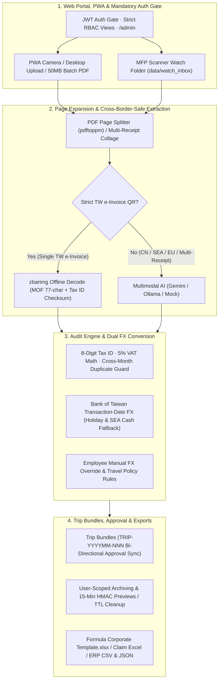

<div align="center">

# 🧾 AI-Invoice-Auditor

### AI-Powered Expense Auditing, Business Trip Bundles & Approval Portal for SMBs
**Multimodal Extraction (Gemini / Ollama) · TW e-Invoice QR Pre-Decode · BOT/Manual FX · Formula-Preserving Excel**

<br/>

[](https://www.python.org/)
[](https://fastapi.tiangolo.com/)
[](#)
[](DOCKER_GUIDE.md)
[](LICENSE)

<br/>

🌐 **[繁體中文](README.md)** | **[English](README_EN.md)**

</div>

---

## 📌 Overview: Built for Small & Medium-Sized Businesses (5–50 People)

For SMBs, startups, and lean operations teams, heavy enterprise expense SaaS suites are costly and complex—yet manual spreadsheet expense reporting still drains hours from traveling employees and finance staff every month:

* **For Traveling Employees**: Gathering dozens of flight/train tickets, hotel folios, and overseas receipts on a multi-day trip meant manually typing rows and hunting for historical exchange rates.
* **For Finance & Accounting**: Verifying 8-digit Tax IDs, checking `Subtotal + 5% VAT == Total`, blocking cross-month duplicate claims, and tracking trip-level vs. receipt-level approvals.
* **For IT & Operations**: Needing a lightweight, privacy-conscious, self-hosted solution that deploys in seconds on an office workstation, Synology/QNAP NAS, or low-cost VPS without SaaS lock-in.

**`AI-Invoice-Auditor`** provides an end-to-end self-hosted expense portal: capture receipts via **PWA mobile camera, MFP scanner Watch Folder, or 50 MB multi-page PDF uploads**, automatically route through **TW e-Invoice QR pre-decoding or Multimodal AI → Compliance Auditing → Transaction-date Bank of Taiwan / Custom FX Conversion → Business Trip Bundles & Formula-Preserving Excel Export → Role-Based Financial Approval**.

---

## ✨ Key Capabilities

1. **📱 Minimalist SaaS UI, 4-Tier RWD & Installable PWA**
   * Clean distraction-free upload workspace with collapsible advanced settings, guide drawer, and on-demand list filters (`🔍 篩選`).
   * **Progressive Web App (`manifest.json` + `/sw.js`)**: Install directly onto mobile home screens for native-like receipt capture without image compression; Service Worker strictly bypasses `/api/` and `/admin` routes so credentials and receipts are never cached.
2. **🤖 Multi-Engine AI Architecture & Easy Extensibility (Gemini / Ollama / OpenAI-Compatible)**
   * **Google Gemini**: High-accuracy multimodal vision parsing across domestic and international receipts into strict Pydantic v2 JSON schemas.
   * **On-Premise Ollama (`llama3.2-vision`, `qwen2.5-vl`, etc.)**: Selectable directly from both the Web UI dropdown and CLI for 100% air-gapped internal inference.
   * **Deterministic Mock Engine & `BaseInvoiceExtractor` Interface**: Run complete offline verification without an API key, or subclass `BaseInvoiceExtractor` (`extract()` / `extract_many()`) to plug in OpenAI GPT-4o, Claude, vLLM, or any OpenAI-compatible endpoint.
3. **🧳 Business Trip Bundles (`出差報銷專案組合`)**
   * Group dozens to 100+ multi-day receipts under a single `TRIP-YYYYMM-NNN` project with incremental chunked batch uploads, automatic travel-day calculation, and advance payment tracking.
   * Bi-directional status sync between parent trips and child receipts: return a single defective receipt (`RETURNED`), resubmit after fixes (`SUBMITTED`), approve/mark paid in bulk, and dynamically extend corporate Excel formulas past any row count.
4. **⚡ High-Volume Paper Ingestion (PDF Split + Cross-Border-Safe QR + Watch Folder)**
   * **Multi-Page PDF Auto-Splitting (`pdftoppm`)**: Upload up to **50 MB** batch-scanned PDFs (images up to 20 MB); each page splits cleanly into an independent receipt with its own presigned preview.
   * **Single-Photo Multi-Receipt Extraction (`multi_receipt`)**: Arrange multiple paper slips on a desk, snap one photo, and extract multiple separate claims automatically.
   * **Cross-Border-Safe Taiwan e-Invoice QR Pre-Decoding (`zbarimg`)**: Prioritizes zero-cost offline QR decoding on single-receipt Taiwan e-invoices (strictly validating the 77-char MOF layout, ROC date, hex totals, and weighted seller Tax ID checksum) while **safely bypassing Mainland China VAT Fapiao (`01,...`), Southeast Asia PromptPay/PayNow, and EU/US URL QRs** so overseas documents always route to multimodal AI.
   * **MFP Scanner Watch Folder (`data/watch_inbox/`)**: Drop scanned PDFs/images into the watched inbox (or into `TRIP-YYYYMM-NNN/` subfolders for automatic trip binding), trigger ingestion from the UI or via optional polling (`WATCH_FOLDER_AUTO_POLL_SECONDS`), and auto-archive processed files under `processed/`.
5. **💱 Dual FX Rate Control (BOT Historical Date Lookup + Manual Override)**
   * **Bank of Taiwan Transaction-Date Rates**: Queries historical BOT exchange quotes via FinMind OpenAPI / Taifex CSV, rolling back weekends/holidays automatically and falling back to **cash-sell rates** for SEA/Asian currencies without spot quotes (`MYR`, `VND`, `IDR`, `PHP`, `KRW`, plus `USD`, `EUR`, `RMB/CNY`, `JPY`, `THB`, `HKD`, `GBP`, `AUD`, `SGD`).
   * **Manual Custom Rates**: Employees can preset a uniform batch rate or adjust any individual foreign-currency receipt (e.g., matching credit card billing statements) via the in-app FX editor (`PATCH /api/records/{id}/exchange-rate`), updating trip NTD totals, [Template.xlsx](Template.xlsx) `Report!J` formulas, and ERP journals.
6. **🛡️ Accounting Guardrails, Mandatory Auth Gate & Strict RBAC**
   * Taiwan MOF 8-digit Tax ID checksum (`[1, 2, 1, 2, 1, 2, 4, 1]`), `Subtotal + 5% VAT == Total` parity, THSR station & high-taxi-fare checks, and SQLite cross-month duplicate invoice detection.
   * Mandatory login gate (`#auth-gate-screen`) + strict RBAC across `employee`, `accountant` (finance), `manager`, and `admin`: employees only see their own uploads, trips, and history (`401`/`403` enforced on cross-user and privileged routes); finance/admin gain access to the Approval Center, Usage Analytics, and **SQLAdmin (`/admin`)**.
7. **🗂️ Receipt Archiving, HMAC Presigned Previews & Enterprise Exports**
   * Receipts persist under `data/uploads/<user_id>/<YYYY-MM>/` and render via **15-minute expiring HMAC-SHA256 presigned URLs** with ownership & path-traversal guards. Exports include formula-preserving [Template.xlsx](Template.xlsx), generic Excel summary, balanced double-entry ERP CSV/JSON journals, and TTL cleanup.

---

## 📊 Comparison Matrix

| Dimension | Manual Spreadsheet Claims | Traditional Rule OCR | AI-Invoice-Auditor (SMB Portal) |
| :--- | :--- | :--- | :--- |
| **Paper Batch Ingestion** | Manual typing & spreadsheet paste | Breaks on tilts, folds, or new layouts | **PWA camera, Watch Folder, PDF auto-split & collage splitting** |
| **Cross-Border Receipts & QR** | Manual FX lookup per receipt | Single-country rigid templates | **Zero-cost TW QR fast path; CN/SEA/EU route safely to AI + BOT date FX** |
| **Trip Grouping & Approval** | Scattered files in email threads | Extraction only, no trip workflow | **TRIP bundles, single-receipt return sync & bulk pay** |
| **Compliance & Access Control** | Eyeball math & shared spreadsheets | No RBAC or duplicate guardrails | **Mandatory Auth Gate RBAC + Tax ID/VAT/duplicate checks + local Ollama** |
| **Cost & Deployment** | High admin time overhead | Expensive per-seat SaaS licensing | **30-sec Docker + SQLite; Cloud Gemini or On-Premise Ollama** |

---

## ⚙️ System Architecture



---

## 🚀 Quick Start

### Option A: Docker Compose (Recommended — 30-Second Setup)

Pre-packaged with `poppler-utils` (PDF splitting) and `zbar-tools` (TW QR decoding), ready for office servers, Synology/QNAP NAS, or cloud VPS. See [DOCKER_GUIDE.md](DOCKER_GUIDE.md) for deployment details:

```bash
git clone https://github.com/Json105/AI-Invoice-Auditor.git
cd AI-Invoice-Auditor

# 1. Create environment configuration (customize secrets & API key before production!)
cp .env.example .env

# 2. Build and start the portal
docker compose up -d --build
```

Open in your browser:
* **Expense & Approval Portal**: `http://localhost:8000/`
* **SQLAdmin Admin Console**: `http://localhost:8000/admin`

---

### Option B: Local Python Web Portal

```bash
git clone https://github.com/Json105/AI-Invoice-Auditor.git
cd AI-Invoice-Auditor
pip install -r requirements.txt

# Optional on Ubuntu/Debian: enable multi-page PDF splitting & TW QR fast decoding
sudo apt-get update && sudo apt-get install -y poppler-utils zbar-tools

# Optional: configure Gemini API key (Mock & local Ollama are selectable in Web UI without a key)
export GEMINI_API_KEY="your-gemini-api-key"

# Start FastAPI server
python3 -m uvicorn src.web.app:app --host 0.0.0.0 --port 8000
```

---

### Option C: CLI Batch Mode

```bash
# 1. Zero-dependency offline demo
python3 -m src.main --input sample_data --engine mock --output output --template Template.xlsx

# 2. Batch extraction with Gemini
export GEMINI_API_KEY="your-gemini-api-key"
python3 -m src.main --input /path/to/invoices --engine gemini --template Template.xlsx

# 3. Air-gapped on-premise mode with Ollama
ollama run llama3.2-vision
python3 -m src.main --input /path/to/invoices --engine ollama --template Template.xlsx
```

Outputs are written to `output/` (and `output/web_sessions/<session_id>/` in Web mode):
* `Travel_Expenses_Report_Filled.xlsx` / `<TRIP_CODE>_Travel_Expenses_Report.xlsx`: Populated formula corporate workbook
* `expense_claim_report.xlsx`: Standardized expense claim spreadsheet
* `erp_journal_entry.csv` / `erp_journal_entry.json`: Balanced double-entry ERP accounting journal lines
* `audit_trail.json`: Full machine-readable audit trail

---

## 🔑 Default Demo Accounts & Production Security Checklist

On first startup (`data/invoices.db`), the database seeds three **demo/testing accounts**:

| Role | Demo Email | Default Password | Access Scope |
| :--- | :--- | :--- | :--- |
| 👑 **Admin (`admin`)** | `admin@company.local` | `Admin1234!` | Full portal access, `/admin` management console, usage/storage cleanup, all claims |
| 💼 **Finance (`accountant`)** | `finance@company.local` | `Finance1234!` | Approval Center (trip & receipt approve/return/mark paid), analytics, `/admin` portal |
| 👤 **Employee (`employee`)** | `employee@company.local` | `User1234!` | Upload/audit receipts, manage own Trip Bundles, adjust own FX rates & view personal history |

> [!CAUTION]
> **Production Hardening Checklist (Required Before Live Use)**:
> 1. **Replace Default Secrets**: Set strong random values for `JWT_SECRET_KEY` and `ADMIN_SESSION_SECRET` in `.env` (e.g., `openssl rand -hex 32`).
> 2. **Remove/Rotate Demo Accounts**: Immediately change passwords or deactivate seeded `@company.local` accounts in `/admin`, provision real company emails, and disable demo quick-fill buttons before public deployment.
> 3. **Serve Over HTTPS**: Use Nginx, Caddy, or **Cloudflare Tunnel + Access** for TLS encryption (HTTPS is also required on mobile for PWA installation & camera capture), and add reverse-proxy rate limiting on `/api/auth/login` plus strict CORS origins.
> 4. **RBAC Boundary**: All core, trip, approval, storage management, Watch Folder, FX edit, and receipt preview/download APIs enforce strict JWT authentication and role/ownership isolation (`401` unauthenticated, `403` cross-user or non-privileged access).
> 5. **Back Up Data**: Regularly back up `./data/` (`invoices.db`, `data/uploads/`, `data/watch_inbox/`) and `./output/`.

---

## ⚙️ Environment Variables

Copy [`.env.example`](.env.example) to `.env` to configure:

| Variable | Requirement | Description |
| :--- | :--- | :--- |
| `GEMINI_API_KEY` | Optional | Google Gemini API key; Mock, TW QR pre-decode, and local Ollama work without it |
| `JWT_SECRET_KEY` | Required in Prod | Signing key for JWT access tokens and HMAC presigned preview links |
| `ADMIN_SESSION_SECRET` | Required in Prod | Session cookie signing key for the `/admin` SQLAdmin console |
| `DATABASE_URL` | Optional | SQLAlchemy connection string (defaults to `sqlite:///data/invoices.db`; PostgreSQL supported) |
| `WATCH_FOLDER_DIR` | Optional | Directory monitored for MFP scanner drop-ins (defaults to `data/watch_inbox`) |
| `WATCH_FOLDER_AUTO_POLL_SECONDS` | Optional | Background Watch Folder polling interval in seconds (`0` disables auto-polling; manual UI scan always available) |
| `S3_BUCKET_NAME` / `S3_ENDPOINT_URL` / `AWS_ACCESS_KEY_ID` / `AWS_SECRET_ACCESS_KEY` | Optional Hook | Object storage configuration for `S3StorageProvider`; falls back to local disk / Docker volume |

---

## 🧩 Customizing Your Company Excel Template

The included [Template.xlsx](Template.xlsx) is a **sanitized generic business-travel expense template** with linked `Report`, `Rates`, `Calc`, and `E category` sheets and dynamic row expansion for 100+ items. To adapt your company's own workbook:

1. Replace [Template.xlsx](Template.xlsx) in the repository root (or specify your path via CLI `-t`).
2. Adjust cell coordinates and category mapping (`F / I / T / H / S / E`) in [`src/template_exporter.py`](src/template_exporter.py) so claims populate seamlessly while keeping your formulas intact.

---

## 📁 Repository Structure

```text
AI-Invoice-Auditor/
├── .env.example                 # Environment variable template (incl. Watch Folder config)
├── DOCKER_GUIDE.md              # SMB Docker deployment guide
├── Dockerfile                   # Lightweight Python 3.10 container (with poppler-utils & zbar-tools)
├── LICENSE                      # MIT License
├── README.md                    # Traditional Chinese documentation
├── README_EN.md                 # English documentation
├── Template.xlsx                # Sanitized formula-based travel expense template
├── docker-compose.yml           # One-command service & volume configuration
├── requirements.txt             # Python dependencies
├── sample_data/                 # Synthetic & sanitized test receipts (TW/overseas/error cases)
├── scripts/
│   └── check-done.sh            # Verification gate (syntax checks + full pytest suite)
├── src/
│   ├── main.py                  # CLI batch processing entrypoint
│   ├── models.py                # Pydantic v2 invoice, FX rate & audit report schemas
│   ├── auditor.py               # Tax ID checksum, math parity & cross-month duplicate auditor
│   ├── database.py              # SQLite WAL / SQLAlchemy models, users, trips & approval workflow
│   ├── exporter.py              # Standard Excel summary & JSON audit trail exporter
│   ├── template_exporter.py     # Formula-preserving Template.xlsx populator & dynamic row formulas
│   ├── erp_exporter.py          # Double-entry ERP journal voucher CSV/JSON exporter
│   ├── extractors/              # Gemini / Ollama / Mock extractors (with multi-receipt extract_many)
│   ├── services/                # auth_service, fx_service, tw_einvoice_qr, document_splitter, watch_folder, ingestion_pipeline, storage_service
│   └── web/                     # FastAPI portal, trips/approval/storage/watch routes, SQLAdmin & PWA + RWD frontend
└── tests/                       # 62 offline unit, multi-role RBAC & integration tests
```

---

## 🧪 Automated Testing & Verification

All **62 tests** run completely offline using `MockExtractor`, `qrencode` QR fixtures, multi-page PDF fixtures, and FastAPI `TestClient` (no external API key required):

```bash
# Run full project verification gate (Python compileall + JS syntax + full pytest suite)
./scripts/check-done.sh

# Or run pytest directly
pytest -v
```

Coverage includes:
* Taiwan 8-digit Tax ID weighted modulo-10 checksums, `Subtotal + 5% VAT == Total` parity, and cross-month duplicate detection.
* Business Trip Bundles CRUD, chunked batch draft isolation, single-receipt return sync, bulk approval/pay, and 100+ row dynamic Excel formula expansion.
* Multi-page PDF splitting (`pdftoppm`), multi-receipt collage extraction, cross-border-safe TW e-Invoice QR decoding vs. CN/SEA/EU fallback, and Watch Folder archiving.
* Bank of Taiwan transaction-date historical FX lookup (weekend rollback & SEA cash-sell fallback) + manual FX overrides.
* Mandatory Auth Gate, cross-role RBAC boundaries, SQLAdmin list views, and PWA / frontend event integrity.

---

## 📄 License

This project is licensed under the **[MIT License](LICENSE)** — free to use, modify, and self-host for your business or team.
