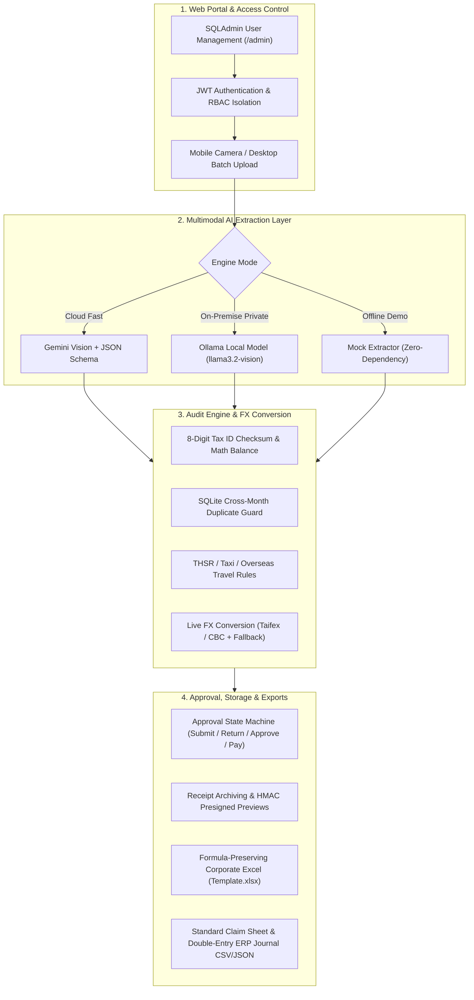

<div align="center">

# 🧾 AI-Invoice-Auditor

### AI-Powered Expense Auditing, Travel Reimbursement & Approval Portal for SMBs
**Multimodal Invoice Extraction, Formula-Preserving Excel Templates & Lightweight Approval Workflow**

<br/>

[](https://www.python.org/)
[](https://fastapi.tiangolo.com/)
[](#)
[](DOCKER_GUIDE.md)
[](LICENSE)

<br/>

🌐 **[繁體中文](README.md)** | **[English](README_EN.md)**

</div>

---

## 📌 Overview: Built for Small & Medium-Sized Businesses (5–50 People)

For SMBs, startups, and lean operations teams, heavy enterprise expense SaaS platforms and custom ERP integrations are often overkill in cost and maintenance—yet manual spreadsheet expense claims still drain hours from traveling employees and finance staff every month:

* **For Employees**: Collecting domestic invoices, high-speed rail tickets, taxi slips, and overseas hotel/ride receipts on business trips still meant typing rows into spreadsheets and looking up FX rates manually.
* **For Finance & Accounting**: Checking 8-digit Tax IDs, verifying `Subtotal + 5% VAT == Total`, preventing cross-month duplicate submissions, and tracking review/reimbursement status in email threads.
* **For IT & Management**: Needing a lightweight, privacy-conscious, zero-overhead tool that deploys cleanly on an office mini-PC, Synology/QNAP NAS, or a \$3.5/mo cloud VPS without Active Directory or external SaaS lock-in.

**`AI-Invoice-Auditor`** delivers an end-to-end self-hosted reimbursement workspace: capture receipts on mobile or upload batches from desktop, let multimodal AI extract structured line items, automatically audit compliance rules, populate your formula-driven corporate Excel workbook, and route claims through a built-in financial approval workflow.

---

## ✨ Key Capabilities

1. **📱 Minimalist SaaS Light UI & Mobile Camera Capture (4-Tier RWD)**
   * Direct mobile camera scanning and desktop drag-and-drop batch uploads (`JPG`, `PNG`, `WEBP`, `PDF`, `TIFF`, `BMP`, plus `.json` fixtures up to 20 MB per file).
   * Responsive 4-tier layout automatically transforms wide desktop tables into touch-friendly mobile cards.
2. **🤖 Dual-Mode AI Extraction (Cloud Speed or Air-Gapped Privacy)**
   * **Google Gemini (Default `gemini-3.7-flash`)**: High-accuracy multimodal vision parsing into strict Pydantic v2 JSON schemas.
   * **On-Premise Ollama (e.g., `llama3.2-vision`)**: Run 100% locally so sensitive vendor pricing and travel records **never leave your internal network**.
   * **Deterministic Mock Engine**: Full offline workflow testing and demo execution without needing an API key.
3. **🛡️ Automated Accounting Guardrails & Cross-Month Deduplication**
   * **Taiwan MOF 8-Digit Tax ID Checksum**: Weighted modulo-10 verification (`[1, 2, 1, 2, 1, 2, 4, 1]`) for buyer and seller Tax IDs.
   * **Mathematical Balance Checks**: Verifies `Subtotal + 5% Tax == Total` and flags low-confidence scans (`< 0.70`).
   * **Cross-Month Duplicate Detection**: Persisted SQLite deduplication stops previously claimed invoice numbers from being reimbursed twice.
   * **Travel & Overseas Rules**: High Speed Rail valid station validation, high taxi fare alerts, and multi-currency overseas receipt support.
4. **📊 Formula-Preserving Excel Templates, Live FX & ERP Vouchers**
   * Populates structured data directly into [Template.xlsx](Template.xlsx) while preserving existing multi-sheet calculation formulas, currency lookups, and embedded charts.
   * Integrates Taiwan official FX data feeds (Taifex / Central Bank with 4-hour cache and offline fallback rates) across `TWD/NT$`, `USD`, `EUR`, `RMB/CNY`, `JPY`, `THB`, `HKD`, `GBP`, `AUD`, and `SGD`.
   * Also generates standard summary sheets (`expense_claim_report.xlsx`), balanced double-entry ERP journal vouchers (`erp_journal_entry.csv` / `.json`), and JSON audit trails (`audit_trail.json`).
5. **✅ Small-Team Financial Approval Workflow**
   * Built-in claim state machine: `SUBMITTED` → `APPROVED` / `RETURNED` / `REJECTED` → `PAID`, with quick preset review chips and employee resubmission after corrections.
6. **🔐 JWT RBAC & SQLAdmin Management Portal (`/admin`)**
   * Role-based access control across `admin`, `finance`/`accountant`, and `employee`, enforcing strict per-user isolation on employee history and receipt downloads.
   * Built-in `/admin` portal (`SQLAdmin`) allows administrators to add company email accounts directly (plaintext passwords are automatically hashed with bcrypt), plus an in-app password change dialog for employees.
7. **🗂️ Receipt Archiving, HMAC Presigned Previews & TTL Cleanup**
   * Original uploaded receipts are archived per user and month (`data/uploads/`), served via **15-minute expiring HMAC-SHA256 presigned preview URLs** (`/api/storage/preview/{token}`) with path-traversal protection, disk metrics, and TTL session cleanup (plus an extensible `StorageProvider` interface for S3 / MinIO / Cloudflare R2).

---

## 📊 Comparison Matrix

| Dimension | Manual Reimbursement | Traditional Rule OCR | AI-Invoice-Auditor (SMB Portal) |
| :--- | :--- | :--- | :--- |
| **Employee Effort** | Manual spreadsheet typing & FX lookup | Heavy manual post-correction | **Snap photo on phone → auto-filled formula Excel** |
| **Unstructured Receipts** | Error-prone on high volume | Breaks on tilts, folds, foreign slips | **Multimodal parsing across local & overseas formats** |
| **Compliance & Anti-Fraud** | Eyeball math & ad-hoc checks | Requires custom regex scripts | **Tax ID checksum, 5% VAT parity & DB duplicate guard** |
| **Review & Archiving** | Files lost in emails/chat | Extraction only, no approval state | **Approval state machine + archived HMAC previews** |
| **Cost & Infrastructure** | High admin time overhead | Expensive licensing & setup | **30-sec Docker + SQLite; Cloud Gemini or Local Ollama** |

---

## ⚙️ System Architecture



---

## 🚀 Quick Start

### Option A: Docker Compose (Recommended — 30-Second Setup)

Ideal for an office host, Synology/QNAP NAS, or low-cost cloud VPS. See [DOCKER_GUIDE.md](DOCKER_GUIDE.md) for deployment details:

```bash
git clone https://github.com/Json105/AI-Invoice-Auditor.git
cd AI-Invoice-Auditor

# 1. Create environment configuration (customize secrets & API key before production!)
cp .env.example .env

# 2. Build and start the portal
docker compose up -d --build
```

Open in your browser:
* **Expense & Approval Portal**: `http://localhost:8000/`
* **SQLAdmin Admin Console**: `http://localhost:8000/admin`

---

### Option B: Local Python Web Portal

```bash
git clone https://github.com/Json105/AI-Invoice-Auditor.git
cd AI-Invoice-Auditor
pip install -r requirements.txt

# Optional: configure Gemini API key (or run with Mock / local Ollama)
export GEMINI_API_KEY="your-gemini-api-key"

# Start FastAPI server
python3 -m uvicorn src.web.app:app --host 0.0.0.0 --port 8000
```

---

### Option C: CLI Batch Mode

Great for automated scripts or quick offline verification:

```bash
# 1. Zero-dependency offline demo
python3 -m src.main --input sample_data --engine mock --output output --template Template.xlsx

# 2. Batch extraction with Gemini
export GEMINI_API_KEY="your-gemini-api-key"
python3 -m src.main --input /path/to/invoices --engine gemini --model gemini-3.7-flash --template Template.xlsx

# 3. Air-gapped on-premise mode with Ollama
ollama run llama3.2-vision
python3 -m src.main --input /path/to/invoices --engine ollama --template Template.xlsx
```

Outputs are written to `output/` (and `output/web_sessions/<session_id>/` in Web mode):
* `Travel_Expenses_Report_Filled.xlsx`: Auto-populated corporate formula workbook (when `--template` / `apply_template` is enabled)
* `expense_claim_report.xlsx`: Standardized expense claim spreadsheet
* `erp_journal_entry.csv` / `erp_journal_entry.json`: Balanced double-entry ERP accounting journal lines
* `audit_trail.json`: Full machine-readable audit report

---

## 🔑 Default Demo Accounts & Production Security Checklist

On first startup (`data/invoices.db`), the database seeds three **demo/testing accounts**:

| Role | Demo Email | Default Password | Access Scope |
| :--- | :--- | :--- | :--- |
| 👑 **Admin (`admin`)** | `admin@company.local` | `Admin1234!` | Full portal access, `/admin` user management, all company claims |
| 💼 **Finance (`finance`)** | `finance@company.local` | `Finance1234!` | Financial Approval Center (Approve/Return/Reject/Mark Paid), ERP & Excel exports |
| 👤 **Employee (`employee`)** | `employee@company.local` | `User1234!` | Submit receipts, view personal history & receipts, resubmit returned claims |

> [!CAUTION]
> **Production Hardening Checklist (Required Before Live Use)**:
> 1. **Replace Default Secrets**: Always set strong random values for `JWT_SECRET_KEY` and `ADMIN_SESSION_SECRET` in `.env` (e.g., `openssl rand -hex 32`).
> 2. **Change Demo Passwords**: Log in or open `/admin` immediately after deployment to rotate or deactivate all seeded `@company.local` credentials and add real team emails.
> 3. **Serve Over HTTPS**: Put Nginx, Caddy, or Cloudflare Tunnel in front of the service for TLS encryption (especially important for mobile camera capture and credential security).
> 4. **Network Boundary Control**: Core upload, history, stats, receipt download, and report export routes (`/api/audit`, `/api/history`, `/api/stats`, `/api/records/{id}/file`, `/api/download/...`) enforce JWT Bearer authentication. Approval workflow and storage lifecycle routes (`/api/approval/*`, `/api/storage/stats`, `/api/storage/cleanup`) are designed for trusted LAN/VPN or reverse-proxy access control; restrict them at your reverse proxy if exposed publicly.
> 5. **Back Up Data**: Regularly back up `./data/` (`invoices.db` + `data/uploads/` original receipts) and `./output/`.

---

## ⚙️ Environment Variables

Copy [`.env.example`](.env.example) to `.env` to configure:

| Variable | Requirement | Description |
| :--- | :--- | :--- |
| `GEMINI_API_KEY` | Optional | Google Gemini API key; when unset, Mock and local Ollama engines remain available |
| `JWT_SECRET_KEY` | Required in Prod | Signing key for JWT access tokens and HMAC presigned preview links |
| `ADMIN_SESSION_SECRET` | Required in Prod | Session cookie signing key for the `/admin` SQLAdmin console |
| `DATABASE_URL` | Optional | SQLAlchemy connection string (defaults to `sqlite:///data/invoices.db`; PostgreSQL supported) |
| `S3_BUCKET_NAME` / `S3_ENDPOINT_URL` / `AWS_ACCESS_KEY_ID` / `AWS_SECRET_ACCESS_KEY` | Optional Hook | Object storage configuration for `S3StorageProvider`; falls back to local disk / Docker volume when unset |

---

## 🧩 Customizing Your Company Excel Template

The included [Template.xlsx](Template.xlsx) is a **sanitized generic business-travel expense template** containing linked `Report`, `Rates`, `Calc`, and `E category` sheets with automatic NTD currency conversion and summary formulas. To use your company's own reimbursement workbook:

1. Replace [Template.xlsx](Template.xlsx) in the repository root (or pass your workbook path via CLI `-t`).
2. Adjust cell coordinates and expense category rules (`F / I / T / H / S / E`) in [`src/template_exporter.py`](src/template_exporter.py) so extracted claims populate directly without disturbing existing Excel formulas or layout.

---

## 📁 Repository Structure

```text
AI-Invoice-Auditor/
├── .env.example                 # Environment variable template
├── DOCKER_GUIDE.md              # SMB Docker deployment guide
├── Dockerfile                   # Lightweight Python 3.10 container image
├── LICENSE                      # MIT License
├── README.md                    # Traditional Chinese documentation
├── README_EN.md                 # English documentation
├── Template.xlsx                # Sanitized formula-based travel expense template
├── docker-compose.yml           # One-command service & volume configuration
├── requirements.txt             # Python dependencies
├── sample_data/                 # Synthetic & sanitized test receipts (TW/overseas/error cases)
├── scripts/
│   └── check-done.sh            # Verification gate (syntax checks + full pytest suite)
├── src/
│   ├── main.py                  # CLI batch processing entrypoint
│   ├── models.py                # Pydantic v2 invoice & audit report schemas
│   ├── auditor.py               # Tax ID checksum, math balance & cross-month duplicate auditor
│   ├── database.py              # SQLite WAL / SQLAlchemy models, users, history & approval workflow
│   ├── exporter.py              # Standard Excel summary & JSON audit trail exporter
│   ├── template_exporter.py     # Formula-preserving Template.xlsx populator
│   ├── erp_exporter.py          # Double-entry ERP journal voucher CSV/JSON exporter
│   ├── extractors/              # Gemini / Ollama / Mock multimodal extractors
│   ├── services/                # JWT auth (auth_service), live FX (fx_service), storage & HMAC preview (storage_service)
│   └── web/                     # FastAPI portal, RBAC/approval/storage routers, SQLAdmin & RWD frontend assets
└── tests/                       # Standalone unit & TestClient integration test suite
```

---

## 🧪 Automated Testing & Verification

All tests run completely offline using `MockExtractor` and in-memory/FastAPI `TestClient` (no API key or live network required):

```bash
# Run full project verification gate (Python compileall + JS syntax + full pytest suite)
./scripts/check-done.sh

# Or run pytest directly
pytest -v
```

Coverage includes:
* Taiwan 8-digit Tax ID weighted modulo-10 checksums, `Subtotal + 5% VAT == Total` parity, and cross-month duplicate invoice detection.
* THSR station validation, taxi high-fare alerts, and multi-currency overseas conversions.
* Formula-preserving population of `Template.xlsx` and ERP double-entry CSV/JSON exports.
* JWT authentication, RBAC user isolation, `/admin` password hashing, and password updates.
* Approval workflow state transitions (`SUBMITTED` → `APPROVED` / `RETURNED` / `REJECTED` → `PAID`) and resubmission.
* Uploaded receipt persistence, HMAC-SHA256 presigned URL validation, and TTL session cleanup.

---

## 📄 License

This project is licensed under the **[MIT License](LICENSE)** — free to use, modify, and self-host for your business or team.
